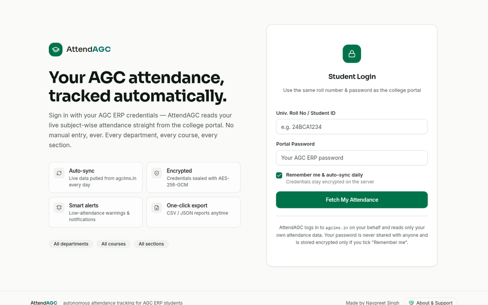
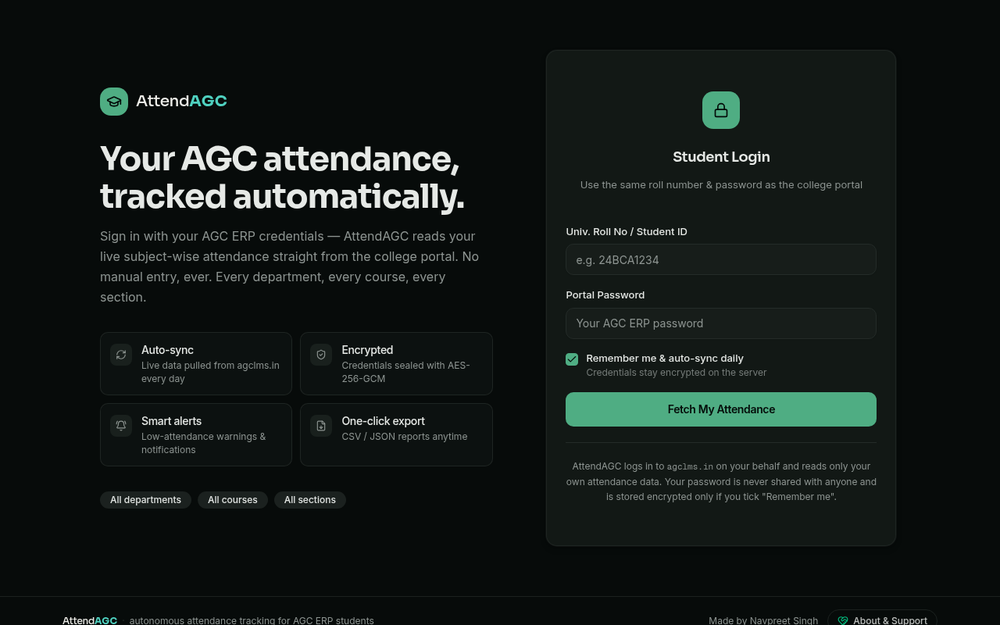
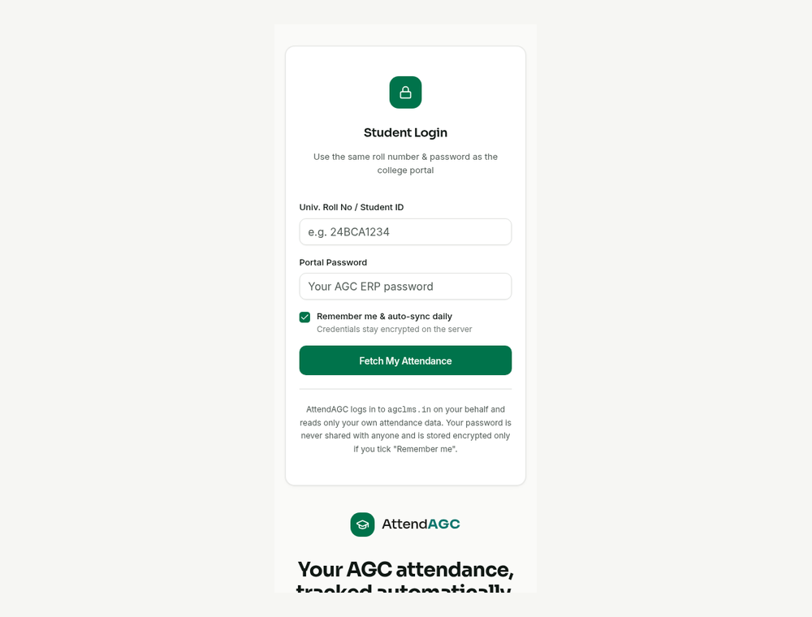

# AttendAGC

**Your AGC attendance, tracked automatically — sign in with your college ERP credentials and see live subject-wise attendance, safe-bunk math and alerts in one place.**

🔗 **Live demo:** [attend-agc.vercel.app](https://attend-agc.vercel.app)




## Features

**Automatic attendance sync**
- Log in with your university roll number and AGC ERP password — AttendAGC reads your live subject-wise attendance from the college portal
- Optional "Remember me & auto-sync daily" with a scheduled daily sync (Vercel Cron)
- Manual sync with a progress overlay and a summary of what changed
- Recent sync activity log of every automatic and manual fetch

**Dashboard**
- Subject-wise attendance cards with status and a personal attendance target
- Trends chart sorted lowest-first, so the subjects at risk stand out
- Full class log per subject
- One-click export of reports as CSV or JSON

**Calculator & simulator**
- How many classes you must attend to reach your target, and how many you can safely skip
- "Semester safe bunks", max reachable %, and a simulated final % for any what-if scenario

**Smart academic planner**
- Upload your academic calendar or timetable (PDF, JPG, PNG, DOC, DOCX)
- AI-assisted extraction (Google Gemini) plus OCR (Tesseract.js), with a review step before saving
- Semester dates, holidays and weekly timetable feed into the attendance projections

**Alerts & app experience**
- Low-attendance notifications in-app and via Web Push
- Installable PWA with offline cache
- Light / dark theme

**Security**
- Stored portal credentials are encrypted with AES-256-GCM, and only if you opt in
- Cookie-based sessions; reads only your own attendance data

## Screenshots

<table>
  <tr>
    <td align="center"><br><sub>Login</sub></td>
    <td align="center"><br><sub>Dark mode</sub></td>
  </tr>
  <tr>
    <td align="center" colspan="2"><br><sub>Mobile</sub></td>
  </tr>
</table>

## Tech stack

| Layer | Tools |
|---|---|
| Framework | Next.js 16 (App Router, API routes), React 19, TypeScript |
| Styling / UI | Tailwind CSS 4, shadcn/ui (Radix UI), Framer Motion, Lucide icons |
| State & data | Zustand, TanStack Query, React Hook Form + Zod |
| Database | Prisma ORM (SQLite locally, PostgreSQL in production) |
| Documents & AI | Google Gemini, Tesseract.js (OCR), pdf-parse, Mammoth |
| Notifications | Web Push (VAPID), service worker |
| Charts | Recharts |
| Hosting | Vercel (with Vercel Cron) |

## Project structure

```
attend-flow/
├── prisma/
│   ├── schema.prisma        # Student, Session, SubjectAttendance, AttendanceLog, SyncEvent, TimetableEntry...
│   └── prepare-db.js        # generates the Prisma client for the right database
├── public/                  # icons, PWA manifest, service worker, OCR data
├── scripts/                 # database migration helpers
└── src/
    ├── app/
    │   ├── api/             # auth, sync, cron, planner, push, settings routes
    │   ├── layout.tsx
    │   └── page.tsx
    ├── components/
    │   ├── attendflow/      # login, dashboard, calculator, planner, trends, notifications
    │   └── ui/              # shadcn/ui components
    └── lib/                 # portal sync, attendance calculator, crypto, push, planner
```

## Getting started

### Prerequisites
- Node.js 18+ (or Bun)
- A database: SQLite works locally; use PostgreSQL in production
- Optional: a Google Gemini API key (planner extraction) and VAPID keys (push notifications)

### 1. Clone
```bash
git clone https://github.com/navpreet-dev/attend-flow.git
cd attend-flow
```

### 2. Install
```bash
npm install
```

### 3. Set up environment variables
Copy `.env.example` to `.env` and fill in your own values:
```env
DATABASE_URL="file:../db/custom.db"
APP_SECRET="your-strong-random-app-secret-32-chars-minimum"
NEXT_PUBLIC_VAPID_PUBLIC_KEY="your-vapid-public-key"
VAPID_PRIVATE_KEY="your-vapid-private-key"
VAPID_SUBJECT="mailto:you@example.com"
CRON_SECRET="your-cron-secret"
GEMINI_API_KEY="your-gemini-api-key"
```
Generate VAPID keys with `npx web-push generate-vapid-keys`.

### 4. Set up the database
```bash
npm run db:generate   # generate the Prisma client
npm run db:push       # create tables from the schema
```

### 5. Run the dev server
```bash
npm run dev
```
Open [http://localhost:3000](http://localhost:3000).

### Other scripts
| Script | What it does |
|---|---|
| `npm run build` | Prepare the Prisma client and build for production |
| `npm run start` | Sync the schema and start the production server |
| `npm run lint` | Run ESLint |
| `npm run db:migrate` | Create and apply a migration |
| `npm run db:reset` | Reset the database |

## How to use the site

1. **Sign in** — enter your Univ. Roll No / Student ID and your AGC ERP password.
2. **Choose auto-sync** — tick "Remember me & auto-sync daily" to keep your data fresh (credentials are stored encrypted).
3. **Check your dashboard** — see each subject's attendance, status and trends against your target.
4. **Plan bunks** — open the calculator to see how many classes to attend or how many you can skip.
5. **Upload your timetable** — in the planner, add your academic calendar and timetable for semester-aware projections.
6. **Stay alerted** — enable notifications to get low-attendance warnings.
7. **Export** — download your report as CSV or JSON anytime.

## Deployment on Vercel

1. Import the repo at [vercel.com/new](https://vercel.com/new).
2. Add the environment variables above under **Settings → Environment Variables** (use a PostgreSQL `DATABASE_URL` in production).
3. Vercel detects Next.js automatically; `vercel.json` schedules the daily `/api/cron/sync` job.

Every push to `main` then redeploys automatically.

## Disclaimer

AttendAGC is a student project and is not an official AGC product. It only reads your own attendance using the credentials you enter.

## Author

**Navpreet Singh**

- GitHub: [@navpreet-dev](https://github.com/navpreet-dev)
- LinkedIn: [navpreetsingh-dev](https://www.linkedin.com/in/navpreetsingh-dev)

If you like this project, a ⭐ on the repo is appreciated.
